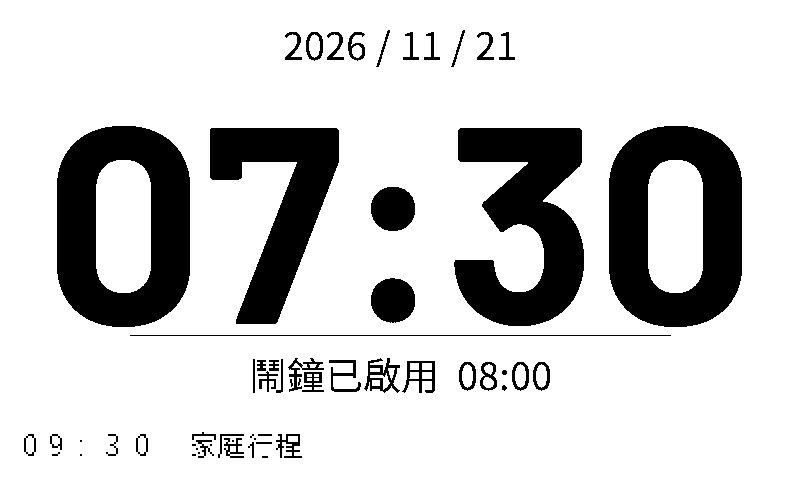

# WebClock 桌鐘使用手冊

面向螢幕，伸手摸到**背面上緣**的三個操作鍵從左至右是 **＋ 選擇、● 確定、× 取消**。主畫面按 ● 進入選單，再用 ＋ 選擇、● 確定；＋ 與 × 在主畫面沒有作用。將桌鐘翻到背面看，順序為 ×、●、＋，每鍵下方都有刻記。頂部的 USB-C 同時支援供電與資料傳輸。時間採台北時區、24 小時制，出廠每日鬧鐘為 07:00、關閉。



## 第一次開機

1. 接上 USB-C 電源。已裝電池時也可開啟電池開關使用。以下使用步驟適用於已刷入桌鐘韌體的成品；裸板先依[刷機說明](README.md#刷入韌體)安裝。
2. **只當床頭鬧鐘**：主畫面按 ● 進入選單，用 ＋ 選「設定時間」設定日期時間；完成後再按 ● 進入選單，用 ＋ 選「每日鬧鐘」設定鬧鐘。離線即可響鈴。
3. **想自動校時或用 OTA**：用手機連桌鐘的 Wi-Fi，依下節設定家中網路。
4. **想讓網頁同步鬧鐘或顯示行事曆**：Wi-Fi 連好後再完成「配對自己的 WebClock」。

## 用手機連上家中 Wi-Fi

1. 首次開機後，在手機的 Wi-Fi 清單選 **WebClock-Setup**。用機背設定標籤或隨機卡上的**這台桌鐘專屬密碼**連線。手機提示「沒有網際網路」時選「保持連線」。同時設定多台時，一次開一台。
2. 開啟自動跳出的設定頁。沒有跳出時，在瀏覽器網址列輸入 **http://192.168.4.1/**。共用手機請使用私密分頁：本版 ESPHome 的 Save 會把 Wi-Fi 密碼放進該次頁面網址，完成後關閉分頁並避免分享網址或截圖。頁首會列出附近的 Wi-Fi；點選家中的 **2.4 GHz** 網路，名稱會自動帶入 **SSID** 欄。也可直接在 **SSID** 欄輸入完整名稱，大小寫與空格都要相同。
3. 在 **Password** 輸入家中 Wi-Fi 的密碼，按 **Save**。若密碼有誤，保持連在桌鐘熱點，重新開設定頁再存一次。桌鐘成功連上後會關閉熱點；手機切回原網路。設定頁上的 **Update** 是韌體上傳；配網只需要 **Save**。
4. 第一次開機若一直沒有連上，配網視窗約十分鐘後關閉。關掉電池開關並拔除 USB-C，再重新供電即可重開。桌鐘本次開機曾成功連線後，路由器短暫斷線時只重試家中網路以節電。更換路由器後若舊網路連不上，重開機等約一分鐘再連熱點。也可使用下方 USB 方法。已連上 Wi-Fi 想同步鬧鐘時，接著做「配對自己的 WebClock」。[ESPHome 配網說明](https://esphome.io/components/captive_portal/)

## 透過 USB 設定家中 Wi-Fi

1. 桌鐘停在一般時間畫面，使用 **USB-C 資料線**連到電腦。電腦維持原有網路。
2. 在電腦版 Chrome 或 Edge 開啟 [ESPHome Web](https://web.esphome.io/)，按 **Connect**，在序列埠選擇器選這台 ESP32-S3 的 USB Serial/JTAG 埠，再按「連線」。
3. 在已連線的裝置面板選 **Configure Wi-Fi／Wi-Fi**，選家中的 **2.4 GHz** 網路，輸入 Wi-Fi 密碼並送出。等候畫面回報連線完成。網路資料透過 USB 的 Improv Serial 傳給桌鐘，成功加入後由桌鐘保存。[ESPHome 官方 USB 配網說明](https://esphome.io/components/improv_serial/)
4. 關閉 ESPHome Web 分頁以釋放序列埠。拔掉 USB 資料線、以電池或供電器重開機，桌鐘會重連已存網路。換路由器或更改密碼時，同樣回到主畫面重做這四步。
5. 看不到埠時，確認線材能傳資料、關掉監控序列埠的程式再連一次。看得到埠但找不到配網功能時，從 USB 配對畫面按 × 回選單，確認裝的是本款韌體。

## 配對自己的 WebClock

這一段只需在首次綁定、換服務或換程式憑證時執行。USB 配對工具在電腦上運作，桌鐘保存設定，完成後可以拔線。使用能從家中 Wi-Fi 到達的服務根網址，例如你自己的 HTTPS 網域；電腦上的 localhost 無法代表桌鐘要連的主機。

1. 登入自己的 WebClock，進入 **程式存取**（`/integrations`）。程式名稱填「床頭桌鐘」，勾 **讀取鬧鐘** 與 **新增、修改及刪除鬧鐘**，按 **建立憑證**。複製只顯示一次的權杖；其餘資源可留空，桌鐘可以管理自己建立的每日鬧鐘。
2. 個人模式可直接讀公開顯示行事曆。若要顯示指定群組，到 WebClock 的群組管理選取目標群組，設定該群組可見的行事曆與提醒，產生一組有效的**六位邀請碼**。受管理模式需要此步驟。程式憑證負責雙向鬧鐘，群組邀請碼負責顯示範圍。
3. 用資料線連桌鐘，關閉 ESPHome Web。在下載的專案根目錄執行下列命令。`uv` 會準備工具所需的 Python 與 pyserial。已有本專案韌體環境時也可執行 `firmware/.venv/bin/python firmware/setup/pair.py`。[uv 安裝說明](https://docs.astral.sh/uv/getting-started/installation/)

   ```sh
   uv run --script firmware/setup/pair.py
   ```

4. 選埠號。依提示在桌鐘**按 ● 進入選單，用 ＋ 選「USB 配對」**，看到「USB 配對」後在電腦按 Enter。輸入服務根網址、貼上程式憑證。個人模式使用公開行事曆直接按 Enter，要顯示群組則選 y。受管理模式或選了群組時，第一次再輸入邀請碼。群組使用 HTTPS；個人自架服務也支援經你確認信任的私人 IPv4 區網 HTTP。該選項會以明文傳輸權杖。
5. 等工具顯示「桌鐘已儲存服務設定並重新開機」。在桌鐘設一次每日鬧鐘，於 WebClock **排程**（`/schedules`）找到「桌鐘每日鬧鐘 wc-…」。改動時間後在網路正常時約 30 秒同步；已開的網頁可能要再等一次重新整理。可反向在網頁改成另一時間，核對桌鐘畫面。
6. 群組工具在目前使用者的 `~/.webclock-desk/` 保存該桌鐘、服務與擁有者專用的顯示憑證，以便斷線或更新程式憑證時重試。程式權杖與邀請碼不寫入這個目錄。請在自己的電腦操作。工具報 401／403 時檢查憑證到期、權限與群組狀態；五分鐘內未完成配對會自動返回選單，選「USB 配對」後按 ● 即可。

## 每個畫面怎麼選

| 畫面或欄位 | ＋ 選擇 | ● 確定 | × 取消 |
|---|---|---|---|
| 主畫面 | 無作用 | 進入選單 | 無作用 |
| 選單 | 下一個項目（循環） | 進入目前項目 | 返回主畫面 |
| 設定時間：年份 → 月份 → 日期 | 當前數字加一，到最大值後回到起點；日期依該月天數循環 | 確認目前欄位，移到下一欄 | 放棄並返回選單 |
| 設定時間：小時 → 分鐘十位 → 分鐘個位 | 小時 0–23、十位 0–5、個位 0–9，各自循環 | 最後一欄確認後套用時間、寫入備援 RTC，返回時鐘 | 放棄並返回選單 |
| 每日鬧鐘：鬧鐘開關 | 切換啟用／停用 | 前往小時 | 放棄草稿並返回選單，原鬧鐘繼續有效 |
| 每日鬧鐘：小時 → 分鐘十位 → 分鐘個位 | 遞增目前欄位 | 最後一欄確認後儲存整筆；連線時同步，返回時鐘 | 放棄草稿並返回選單 |
| USB 配對 | 無操作 | 無操作 | 返回選單並恢復 USB Wi-Fi 配網 |
| 響鈴 | 開啟確認後，在取消／確認間移動 | 開啟「取消響鈴」；在「確認」上停止響鈴 | 關閉取消確認（未開啟時無作用），繼續響鈴 |

**響鈴時**：畫面保留日期、時間與行事曆，時間下方出現「取消響鈴」。按 ● 開啟確認，預設選「取消」；按 ＋ 移到「確認」，再按 ● 才停鈴。按 × 只關閉確認，不會停鈴；未確認時最多響 60 秒，明日設定保留。

**範例：設定每天 07:30。** 在主畫面按 ● 進入選單，按 ＋ 移到「每日鬧鐘」，按 ●。用 ＋ 切到「已啟用」，按 ●。小時調為 07 後按 ●，分鐘十位調為 3 後按 ●，個位調為 0 後按 ●；最後一次 ● 儲存並返回時鐘。要關閉它，重新進入選單的「每日鬧鐘」，選停用後一路確認至最後一欄。

主畫面中央最大字是目前時間；尚未校時時顯示 `--:--`。底部有可顯示的行程時會列出時間和標題，長文字每八秒移動一段。清單清空、配對權限失效或失聯約一分鐘後，舊行程會清除。完全失電時電子紙會停留在最後畫面，響鈴需要主電源；RTC 備援電池只負責保時。

## 斷網後會怎樣

本機校時、每日鬧鐘、取消與停鈴都可繼續用；當次響鈴最長約 60 秒。本機離線修改會保留，重連後再同步。同一筆在兩端都被修改時採服務端值。網頁刪除該筆，或將它改成桌鐘無法表示的規則時，桌鐘會停用這筆並提示；需要恢復時，在桌鐘重新確認一次每日鬧鐘。

若電腦顯示配對成功、桌鐘卻沒有同步，先確認桌鐘時間正確、Wi-Fi 可從桌鐘連到同一個根網址、HTTPS 憑證鏈受桌鐘信任，並在網頁確認程式憑證仍有效。USB 配對只授權桌鐘自己的每日鬧鐘與相應的行事曆。
