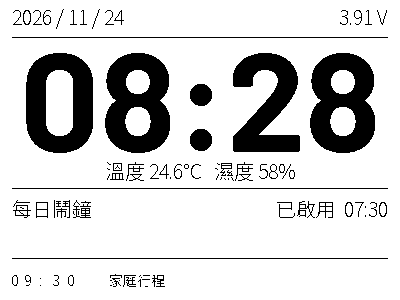

# 微雪 4.2 吋 RLCD 桌鐘韌體

適用於 Waveshare ESP32-S3-RLCD-4.2。主畫面橫向顯示 400 × 300 像素的時鐘，右上角顯示 ADC 量到的電池端電壓。讀值會隨充電或響鈴負載改變。[原廠板型說明](https://docs.waveshare.com/ESP32-S3-RLCD-4.2)

板載 SHTC3 與 RTC 共用 I²C，溫濕度每分鐘取樣，可在三鍵選單切換顯示。[顯示或隱藏溫濕度](使用手冊.md#顯示或隱藏溫濕度) · [原廠硬體配置](https://docs.waveshare.com/ESP32-ESPHome-Tutorials/Example-RLCD-Voice)



[本板使用手冊與八個畫面預覽](使用手冊.md) · [400 × 300 版面原始碼](screen.yaml) · [自訂音樂](AUDIO.md)

## USB 刷入

依[韌體環境說明](../README.md)準備 Python 環境。在專案根目錄執行以下命令，兩次密碼提示分別輸入本機專用的 OTA 與首次配網熱點密碼。以實際 USB 埠取代範例埠。

```sh
cp -n firmware/rlcd-clock/secrets.example.yaml firmware/rlcd-clock/secrets.yaml
read -rs 'WEBCLOCK_DESK_OTA_PASSWORD?輸入本機 OTA 密碼：'
read -rs 'WEBCLOCK_DESK_AP_PASSWORD?輸入本機熱點密碼（至少 8 字元）：'
export WEBCLOCK_DESK_OTA_PASSWORD WEBCLOCK_DESK_AP_PASSWORD
firmware/.venv/bin/esphome run firmware/rlcd-clock/clock.yaml --device /dev/cu.REPLACE_WITH_USB_PORT
```

首次開機使用英文。主畫面按 ● 進入選單，選 **Set time** 與 **Daily alarm** 即可離線設定時間與鬧鐘；要換語言，進入 **Display settings → Language**。連線時透過 `WebClock-Setup` 或 USB 配網，依[RLCD 使用手冊](使用手冊.md#配網與-usb-配對)進行 USB 配對。後續 OTA 使用相同密碼與 YAML，將 USB 埠換成桌鐘的區網 IP。

## 操作與音樂

三個操作鍵分別是 **＋ 選擇、● 確定、× 取消**。已啟用的每日鬧鐘可選「跳過下一次」、「恢復響鈴」或「取消鬧鈴」。響鈴時按 ●、用 ＋ 移到「確認停止」、再按 ● 停止。原廠側鍵保留供電源和維修操作。

將自訂音樂存為 FAT32 microSD 根目錄的 `alarm.wav`，插卡並開機後即可作為鬧鈴。音檔格式、轉檔指令和內建提示音的啟用條件見[自訂鬧鈴說明](AUDIO.md)。

## 維護與移植

兩板共用 `core/desk.yaml` 的排程、按鍵、RTC、配對、離線同步。RLCD 使用自己的 [400 × 300 版面](screen.yaml)，EE04 使用 `views/classic-frame.yaml`。兩者共用按需重繪與跑馬燈。每款板在自己的 `clock.yaml` 指定顯示驅動、字級與三鍵接腳；音訊 package 提供 `mix_audio`，依本機響鈴狀態及服務端音量控制輸出。EE04 使用蜂鳴器，本板使用喇叭。兩款都由 `core/esp32s3.yaml` 載入相同分割表，升級後維持原有 NVS 與 OTA 位址。

若螢幕畫面上下顛倒，可將本板 `clock.yaml` 的 `display.rotation` 由 `0°` 改為 `180°`。

## 驗證

[畫面圖集](screens.png)使用編譯後的字模和本板繪圖程式產生，涵蓋主畫面、選單、顯示設定的兩頁選項、校時、跳過一次、停鈴確認及 USB 配對。三語介面字型採用 [Noto Sans CJK TC／OFL](../views/fonts/NotoSansTC-OFL.txt) 的子集。

本板的 ST7305 驅動固定於已驗證的 Git 提交，首次編譯需要網路。實板驗收時，請核對螢幕方向、文字對比、SHTC3 讀值、溫濕度切換與重開機記憶、三個外接按鍵、配對後雙向同步、拔掉 USB 的電池電壓與離線響鈴，再測喇叭音量及停止操作。[微雪板級文件](https://docs.waveshare.com/ESP32-S3-RLCD-4.2) · [顯示驅動](https://github.com/kylehase/ESPHome-ST7305-RLCD/tree/5a3e9456c94e2eb85280c24e6c2e18b1f7e03406)
