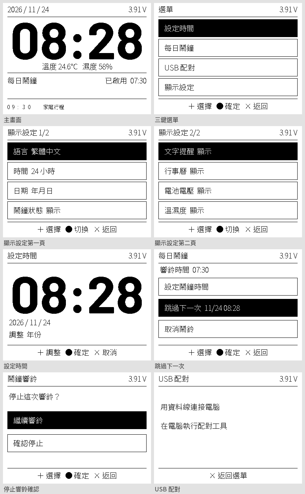

# 微雪 4.2 吋 RLCD 桌鐘使用手冊

**首次開機使用英文。** 主畫面按 **●**，用 **＋** 選 **Display settings** 並按 **●**。第一項 **Language** 按一次 **●** 即為繁體中文，再按一次是日本語。設定自動儲存。下方畫面與操作名稱採繁體中文。

兩款外殼都用同一份 RLCD 韌體。面向螢幕，頂面由左至右為 **＋ 選擇或調整、● 確定、× 返回或取消**。裸板先依[本板刷機說明](README.md#usb-刷入)安裝。

## 看時間、電池與行程

主畫面中央顯示時分，上方顯示日期及電池端電壓，下方列出每日鬧鐘開關與時間。電壓每分鐘取樣一次，充電和喇叭響鈴時可能波動。無有效時間時顯示「等待校時」和「--:--」。底部平時提示「● 進入選單」；有行事曆內容時會改為跑馬燈，此時仍可按 ● 開啟選單。

## 顯示或隱藏溫濕度

主畫面按 **●**，用 **＋** 選「顯示設定」，按 **●** 進入。再用 **＋** 移至「溫濕度」，按 **●** 切換顯示或隱藏。按 **×** 回到選單，再按一次回主畫面。首次使用預設顯示；更新前已隱藏溫濕度的桌鐘會沿用原設定。

同一選單可將時間設為 24 小時、12 小時或隱藏，日期設為年月日、月日或隱藏。鬧鐘狀態、文字提醒、行事曆與電池電壓皆可個別開關。設定在本機自動儲存，離線也能更改。[顯示選項與網頁傳送對象](../README.md#設定每台桌鐘的顯示內容)

內建 SHTC3 每 60 秒讀取一次。開啟時，大時鐘下方顯示攝氏溫度與相對濕度，尚無有效讀值的項目以 `--` 表示；隱藏時大時鐘會回到原本的垂直位置。兩款按鍵外殼的操作相同。[微雪板級說明](https://docs.waveshare.com/ESP32-ESPHome-Tutorials/Example-RLCD-Voice#52-shtc3-temperature-and-humidity)

## 設定時間與鬧鐘

1. 主畫面按 ●，用 ＋ 選「設定時間」，按 ● 進入。依序調整年、月、日、小時、分鐘十位及個位。＋ 增加目前數值，● 前往下一欄；最後一次 ● 儲存，× 放棄編輯。
2. 回到選單進入「每日鬧鐘」。首次設定時用 ＋ 切成「已啟用」，按 ● 依序設定時、分並儲存。已啟用的鬧鐘會先列出三個選項，反白列是目前選擇。
3. **跳過下一次**會列出略過的日期與時間。按 ● 套用，主畫面會標出已跳過的時段，之後的每日鬧鐘照常響。在原定時間前回到同一頁選「恢復響鈴」即可撤回。
4. **取消鬧鈴**會停用每日鬧鐘，保留原設定時間。若只想讓正在響的這一次安靜，請用下面的停鈴操作。

## 響鈴時

按 ● 開啟「停止這次響鈴？」。預設反白「繼續響鈴」；要停鈴時，按 ＋ 選「確認停止」，再按 ●。按 × 回到響鈴畫面。自訂曲目放在 FAT32 microSD 的根目錄，檔名為 `alarm.wav`。[音樂格式、轉檔與試聽驗收](AUDIO.md)

## 配網與 USB 配對

離線設定時間和每日鬧鐘即可單機使用。想同步 WebClock 鬧鐘或顯示行事曆時，先讓桌鐘連上家中 2.4 GHz Wi-Fi，再配對服務。

1. 首次開機等約一分鐘，以手機加入 `WebClock-Setup` 並輸入刷機時設定的熱點密碼。開啟配網頁，選家中 Wi-Fi 並按 **Save**。若沒有自動開啟，前往 `http://192.168.4.1/`。共用手機請使用私密分頁，儲存後關閉，避免保留帶有密碼的配網網址。
2. 登入 WebClock 的「程式存取」，建立具有「讀取鬧鐘」與「新增、修改及刪除鬧鐘」權限的憑證。若使用受管理模式或指定群組，另備該群組的六位邀請碼。
3. 用 USB-C **資料線**連接桌鐘與電腦。在專案根目錄執行 `firmware/.venv/bin/python firmware/setup/pair.py`。依提示選序列埠，在桌鐘選單選「USB 配對」並按 ●，再於電腦輸入桌鐘可連到的服務網址和憑證。
4. 工具回報已儲存且桌鐘重新啟動後，在桌鐘設定每日鬧鐘，再到網頁「排程」核對時間。等待配對時可用 × 返回選單。
